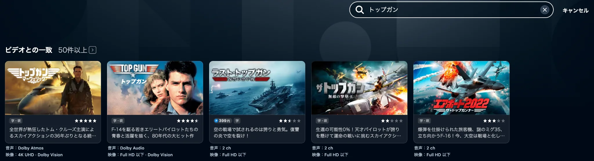
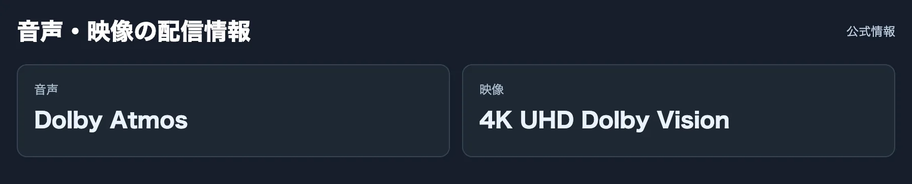
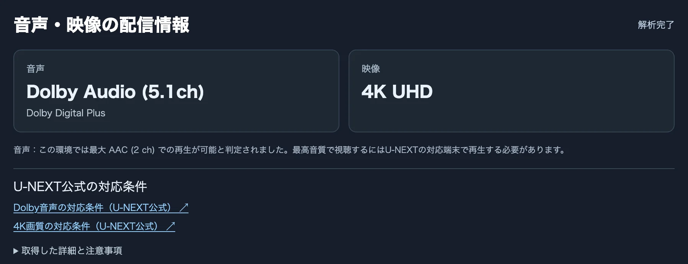
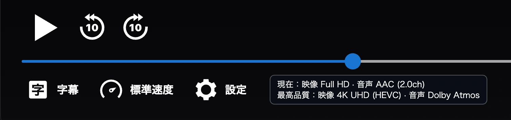
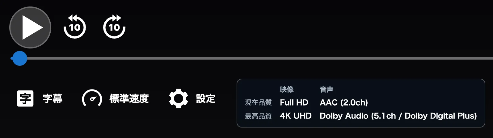
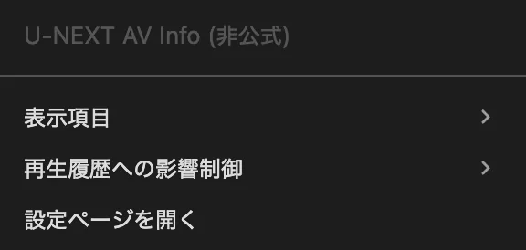
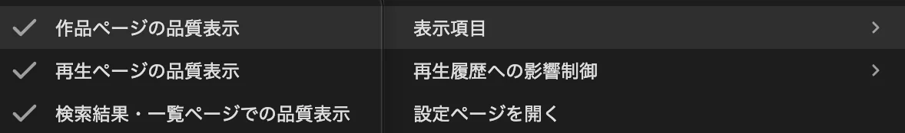
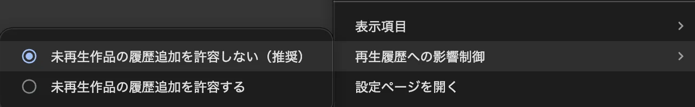
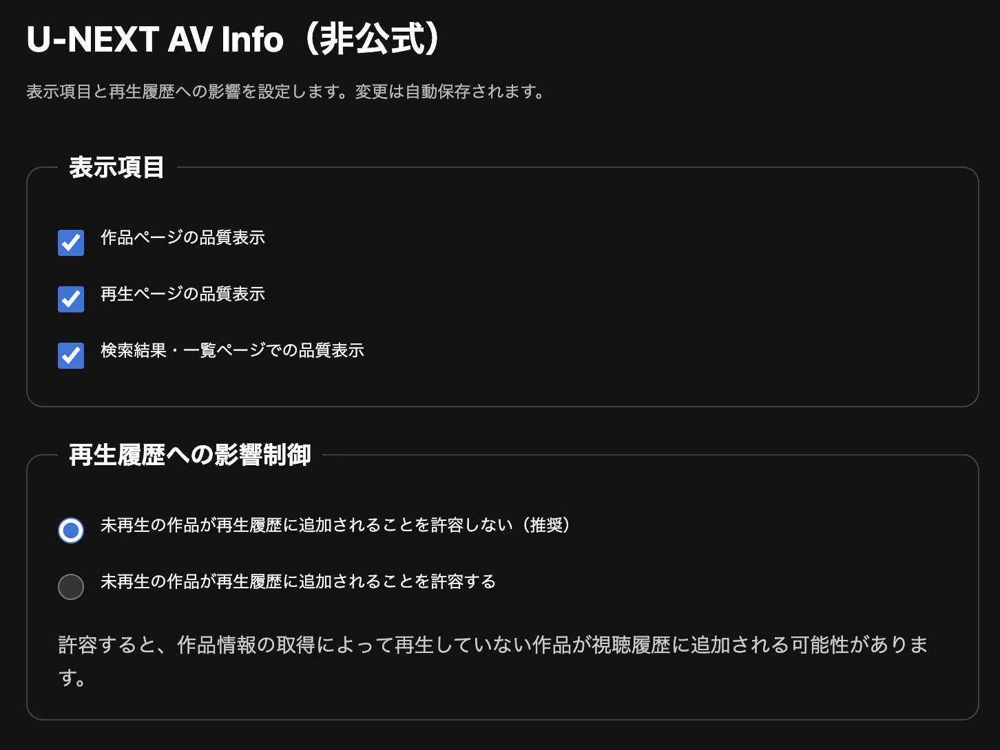

# U-NEXT AV Info

**U-NEXTで配信されている作品の映像・音声品質を、作品探しや再生中に確認できる非公式ブラウザ拡張機能**です。

作品を探しているときは、検索結果や作品ページに **4K UHD・Dolby Vision・Dolby Atmos** などの情報を追加します。再生中は、**現在の再生品質**と**取得できた最高品質**を比較できます。パソコンではなく4K・サラウンド対応のテレビなどで見る作品を選ぶ際にも役立ちます。

> [!IMPORTANT]
> **初期設定では、作品詳細を見るだけで未再生作品が視聴履歴に追加されることを避ける設定**になっています。この設定で表示される配信品質は、U-NEXTの公開リスト・検索結果からの**推定**です。実際の画質や音声形式を確定するものではありません。

## どんなことができる？

### 1. 作品を探しながら音声・画質を確認

トップページや検索結果、各種一覧に並ぶ作品カードの**下**に、音声と映像の情報を2行で表示します。

*検索結果での表示例。音声・映像の情報は、各作品カードの外側・直下に表示されます。*

表示候補は、音声が「Dolby Atmos」「Dolby Audio」「2 ch」、映像が「4K UHD」「Full HD 以下」（Dolby Vision対応候補は併記）です。

**作品詳細を開いている間は一覧用の表示を隠し、作品詳細専用のカードを表示します。** この切り替えはU-NEXTの画面URLに付く `td` パラメータを使って判定します。再生画面では一覧用表示を行いません。

### 2. 作品詳細で配信品質の目安を確認

作品詳細の「音声・映像の配信情報」カードで、対応している可能性がある音声・画質を確認できます。

- **初期設定（推奨）**：公式の4K・Dolby Vision・Dolby Atmos特集、および「ドルビー」の検索結果を使って表示します。再生関連の情報取得は実行しません。
- **視聴履歴への追加を許容した設定**：配信プレイリストなどの解析を用い、取得可能な解像度・映像形式・音声形式と、判定できた音声のチャンネル数（例：`Dolby Audio (5.1ch)`）を表示します。音声コーデック（例：`Dolby Digital Plus`）は補足欄に表示します。Dolby Atmosではch数を主表示に付けません。

詳細解析時にDolby Digital Plusの5.1chを取得できた場合は、**「Dolby Audio (5.1ch)」** とチャンネル数を表示し、その下に **「Dolby Digital Plus」** とコーデックを表示します（Dolby Atmosでは主表示にch数を付けません）。

*視聴履歴への追加を許容した場合の表示例。*

初期設定で表示される「2 ch」は、ステレオ配信を実測・確認したという意味ではありません。また「Full HD 以下」にはHD・SD画質の作品が含まれる可能性があります。

*上の画像は初期設定での表示例です。履歴追加を許容した詳細解析モードでは、解析可能な情報が増える場合があります。*

### 3. 再生中の「現在品質」と「最高品質」を比較

再生画面では、プレーヤーの設定ボタン付近に、映像・音声の比較表が表示されます。

- **現在品質**：再生中の動画・音声トラックから取得できた情報。履歴追加を許容する設定では、取得できたDolby音声のch数も表示します
- **最高品質**：プレイリストなどから解析できた配信情報。4K・Dolby対応の公式掲載情報も判定に利用します。履歴追加を許容する設定では、判明したDolby Audioのch数とコーデックも表示します。

例えばDolby Digital Plusの5.1chを検出した場合、履歴追加を許容する設定では再生画面の最高品質に **`Dolby Audio (5.1ch / Dolby Digital Plus)`** と表示されます。

*再生中の品質と配信情報から取得した最高品質を比較する表示例。*

「最高品質」は**今使っているブラウザで必ず再生できる品質**を意味しません。機器やアプリ、通信環境、選択した音声トラックなどによって結果は変わります。

## 使い方と設定

### 拡張機能をON・OFFする

| ON（有効） | OFF（無効） |
|:---:|:---:|
|  |  |

ブラウザのツールバーで **U-NEXT AV Infoのアイコンを左クリック**すると、拡張機能全体のON・OFFを切り替えます。OFFでは品質表示と拡張機能からの追加照会を停止し、アイコンに「OFF」と表示します。状態は保存されます。

### 表示内容と視聴履歴への影響を設定する

右クリックメニューの「表示項目」から、表示場所を個別に切り替えられます。

「再生履歴への影響制御」では、作品詳細で追加解析を許容するかを選べます。

**拡張機能アイコンを右クリック**して、表示項目と視聴履歴に関する設定を変更できます。「設定ページを開く」からも操作できます。

| 設定 | 初期値 | 内容 |
|---|---|---|
| 作品ページの品質表示 | ON | 作品詳細専用カードを表示 |
| 再生ページの品質表示 | ON | 再生中の現在品質・最高品質を表示 |
| 検索結果・一覧ページでの品質表示 | ON | 各作品カードの下に品質情報を表示 |
| 未再生作品の履歴追加を許容しない | **選択済み（推奨）** | 作品詳細では再生関連APIを照会しない |
| 未再生作品の履歴追加を許容する | 未選択 | 作品詳細で配信プレイリスト解析を行えるようにする |

3つの表示項目はそれぞれ独立してON・OFFできます。履歴に関する2項目は、どちらか一方だけを選びます。**再生ページでの解析は、履歴に関する設定とは独立**しています。

### 設定ページからまとめて変更する

右クリックメニューの **「設定ページを開く」** を選ぶと、同じ項目を1画面で設定できます。変更は自動保存されます。

## 表示の読み方・注意点

| 表示 | 意味と注意点 |
|---|---|
| Dolby Atmos | 公式のDolby Atmos特集に掲載されている作品の候補 |
| Dolby Audio | 「ドルビー」検索に該当する作品の候補。**5.1ch以上を保証しません** |
| 2 ch | 上記の公式情報に一致しなかったときの既定表示。ステレオ確定ではありません |
| 4K UHD | 公式4K特集に掲載されている作品の候補 |
| Dolby Vision | 公式Dolby Vision特集に掲載されている作品の候補 |
| Full HD 以下 | 公式4K特集に一致しなかったときの既定表示。**Full HD確定ではなく、HD・SDの可能性もあります** |

推定表示は配信形式の網羅的な検証ではありません。字幕・吹替、端末、契約、配信条件などで実際の再生品質は異なります。作品の視聴前に詳細を確認したい場合も、**推定情報と実際のトラック解析結果は区別**してください。

> [!CAUTION]
> **「未再生作品の履歴追加を許容する」を選ぶと、作品詳細を開いただけで視聴履歴に追加される可能性があります。** 履歴への意図しない追加を避ける場合は、初期設定を維持してください。

## インストール

デスクトップ版ブラウザ向けのインストール手順です。Chrome・Edgeなどでは、一度追加すればブラウザを再起動しても利用できます。

### 共通の準備

1. このリポジトリの <strong>[Code → Download ZIP](https://github.com/Plana-ria/unext-av-info/archive/refs/heads/main.zip)</strong> から最新版をダウンロードします。
2. ZIPファイルを解凍します。<strong>`manifest.json` が入っているフォルダ</strong>を確認してください。
3. 以下から使用するブラウザの手順に従って読み込みます。

### Google Chrome

1. アドレスバーに `chrome://extensions/` と入力します。
2. <strong>デベロッパーモード</strong>をオンにします。
3. <strong>パッケージ化されていない拡張機能を読み込む</strong>をクリックし、`manifest.json` のあるフォルダを選びます。

### Microsoft Edge

1. アドレスバーに `edge://extensions/` と入力します。
2. <strong>開発者モード</strong>をオンにします。
3. <strong>展開して読み込み</strong>（Load unpacked）をクリックし、`manifest.json` のあるフォルダを選びます。

### その他のChromium系ブラウザ

以下のブラウザでも同じファイルを使用できます。インストール後にU-NEXTの作品情報・再生情報が表示されるか確認してください。

<strong>Brave</strong>

<ol>
<li>アドレスバーに <code>brave://extensions/</code> と入力します。</li>
<li><strong>デベロッパーモード</strong>（Developer mode）をオンにします。</li>
<li><strong>パッケージ化されていない拡張機能を読み込む</strong>（Load unpacked）から <code>manifest.json</code> のあるフォルダを選びます。</li>
</ol>

Brave Shieldsなどの保護設定により、U-NEXTでの動作が変わる場合があります。

<strong>Vivaldi</strong>

<ol>
<li>アドレスバーに <code>vivaldi://extensions/</code> と入力するか、メニューの <strong>ツール → 拡張機能</strong>を開きます。</li>
<li><strong>開発者モード</strong>（Developer mode）をオンにします。</li>
<li><strong>解凍してロード</strong>（Load unpacked）から <code>manifest.json</code> のあるフォルダを選びます。</li>
</ol>

<strong>Opera / Opera GX</strong>

<ol>
<li>アドレスバーに <code>opera://extensions/</code> と入力します（拡張機能管理画面を開きます）。</li>
<li><strong>開発者モード</strong>（Developer mode）を有効にします。</li>
<li><strong>解凍済み拡張機能を読み込む</strong>（Load unpacked）から <code>manifest.json</code> のあるフォルダを選びます。</li>
</ol>

※Opera / Opera GXではバージョンによって画面上の名称が異なる場合があります。

<strong>Arc（デスクトップ版）</strong>

<ol>
<li>Arcの拡張機能管理画面を開きます（<code>arc://extensions/</code> またはメニューの拡張機能管理）。</li>
<li><strong>Developer mode</strong> をオンにします。</li>
<li><strong>Load unpacked</strong> から <code>manifest.json</code> のあるフォルダを選びます。</li>
</ol>

※Arcはプラットフォームやバージョンによって拡張機能管理画面が異なる場合があります。

### Firefox（一時的なインストール）

<strong>Firefoxでは、この方法で追加した拡張機能は一時的なものです。Firefoxを終了・再起動すると削除されるため、次回利用するときは再度読み込んでください。</strong>

1. Firefoxのアドレスバーに `about:debugging` と入力します。
2. 左側の <strong>この Firefox</strong> を選びます。
3. <strong>一時的なアドオンを読み込む…</strong> をクリックします。
4. 解凍したフォルダ内で、元の `manifest.json` を `manifest.chromium.json` に名前変更し、`manifest.firefox.json` を `manifest.json` に名前変更します。
5. Firefoxで、その `manifest.json` を選びます。

※Firefoxでは専用の設定ファイルを使用します。Chrome・Edgeなどでは元の `manifest.json` をそのまま使用してください。

### インストール後・更新方法

U-NEXTの作品詳細ページと再生ページを開き、表示を確認してください。すでにページを開いている場合は再読み込みしてください。

- <strong>Chromium系</strong>：最新版のファイルに差し替えて拡張機能管理画面で <strong>再読み込み</strong>をクリックし、U-NEXTのページも再読み込みします。ローカル読み込み版は自動更新されません。
- <strong>Firefox</strong>：`about:debugging` にある拡張機能の <strong>再読み込み</strong>をクリックします。Firefoxを再起動した場合は再度一時インストールしてください。

## 制限事項

- U-NEXT側の仕様変更によって、表示や解析が動作しなくなる場合があります。
- 取得した公式特集・検索情報が不完全、または更新できない場合は、情報が表示されなかったり古い結果が残ったりすることがあります。
- 未購入のポイント作品など、配信情報を取得できない作品があります。
- 再生中に表示する最高品質は、端末・ブラウザでの再生可否を保証しません。Dolby Atmosなどを正しく識別できない場合もあります。

## エンジニア向け：動作の仕組み

この拡張機能は、U-NEXTのページに品質表示を追加する **Manifest V3** のブラウザ拡張です。メインの処理はブラウザ内で行い、作品ごとの品質の目安と、再生時のトラック解析結果を使い分けます。

### データ取得の2つの経路

1. **作品一覧・初期設定の作品詳細**：U-NEXTの4K UHD／Dolby Vision／Dolby Atmos特集と「ドルビー」キーワード検索の作品IDを取得し、表示中の作品IDに照合します。各一覧の結果は原則24時間キャッシュし、更新できない場合は既存の情報を保持します。**この経路では再生関連APIを呼びません。**
2. **再生画面・履歴追加を許容した作品詳細**：U-NEXTのGraphQL APIからプレイリスト情報を取得し、DASH MPDの映像・音声トラックを解析します。Dolby Atmosの識別には音声初期化セグメントの`dec3`情報なども利用します。この経路は視聴履歴や再生セッションに影響する可能性があります。

表示用のページ判定では、URLの `td` パラメータが存在する間は一覧用品質表示を停止し、`/play/` でも停止します。それ以外のページでは一覧表示処理を許可します（実際に表示されるのは対象作品カードが検出できた場合です）。

ブラウザの再生状態の観測と配信情報の読み取りを行いますが、**映像本編の復号やDRMの解除は行いません**。

### ソースコードの案内

| ファイル | 主な役割 |
|---|---|
| `manifest.json` / `manifest.firefox.json` | ブラウザごとの拡張機能設定・読み込むスクリプト |
| `background.js` | ON/OFF、右クリックメニュー、保存設定、拡張機能からの通信 |
| `options.html` / `options.js` | 設定画面 |
| `content.js` | 作品詳細ページの品質カードとMPD解析 |
| `probe.js` | ページ側での作品ID・API通信情報の取得、各照会処理 |
| `dolby-feature.js` | 公式特集・検索結果の取得・キャッシュ・作品ID照合 |
| `list-quality.js` | 一覧カード下の品質表示、`td`による抑制 |
| `playback-hook.js` | 再生時のメディア情報取得 |
| `playback-ui.js` | 再生画面での現在品質・最高品質表示 |

詳細な実装を確認する場合は、まず`manifest.json`でスクリプトの読み込み順を確認し、上記の担当ファイルを参照してください。U-NEXTのAPI仕様や画面構造は変更される可能性があります。

## セキュリティと免責

Cookie、認証トークン、署名付きURL、HAR、個人情報などをIssueや公開リポジトリに投稿しないでください。

### 免責事項

- 本ツールは個人が開発した非公式のChromium系ブラウザ拡張機能であり、U-NEXT、Dolbyおよび関連企業とは関係ありません。また、各社による承認・保証を受けたものではありません。
- 本ツールが表示する映像・音声情報および再生対応判定について、正確性、完全性、最新性を保証するものではありません。実際の再生品質や利用可能な機能は、端末、ブラウザ、契約状況、配信条件などによって異なります。
- U-NEXTやブラウザなどの仕様変更により、本ツールの一部または全部が予告なく利用できなくなる場合があります。継続的な提供、動作保証、サポートは約束していません。
- 本ツールはU-NEXTの非公開APIを利用しています。利用に際しては、U-NEXTの利用規約および適用される法令を確認してください。
- 本ツールの利用によって生じた不具合、データの損失、サービス利用上の問題、その他の損害について、開発者は適用法令で認められる範囲において責任を負いません。
- 本ツールの利用は各自の判断と責任で行ってください。
