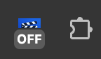
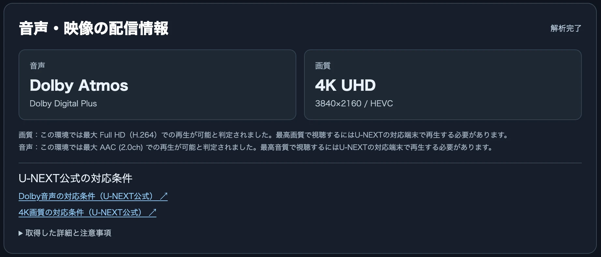
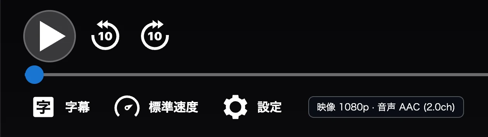

# U-NEXT AV Info

U-NEXTの作品詳細ページや再生ページで、<strong>映像・音声の品質情報を確認できる</strong>ブラウザ拡張機能です。作品詳細ページの自動解析は設定で許可した場合のみ有効です。

作品詳細ページの自動解析を許可すると、再生前に<strong>4K UHDやDolby Atmosへの対応状況</strong>、映像・音声のコーデック、チャンネル数などを確認できます。さらに、現在使用しているブラウザで最高品質の再生に対応しているかを判定し、対応していない場合は注意文を表示します。

動画の再生中には、<strong>現在の映像・音声品質と、再生時のMPD内最高品質</strong>を確認できます。

※U-NEXT非公式の拡張機能です。

## 重要：視聴履歴への影響

> [!CAUTION]
> **作品ページでの自動解析を許可していると、動画を再生せずに作品詳細ページを開いただけでも、U-NEXTの視聴履歴にその作品が記録される可能性が高いです。**

配信情報の取得時にU-NEXTの再生関連APIを呼び出すためです。視聴履歴への影響を避けたい場合は、オプションで「作品ページではカードを表示しない」を選ぶか、ツールバーから拡張機能をOFFにしてください。

## 視聴履歴に関する設定

ブラウザのツールバーにある **U-NEXT AV Infoのアイコンを右クリック** すると、メニューから次の2つのモードを直接選択できます。選択中のモードにはチェックが付き、設定は保存されます。別の設定画面を開く必要はありません。

- **作品ページではカードを表示しない（初期設定・推奨）**：作品詳細ページでは拡張機能独自のプレイリストAPIを呼び出しません。
- **視聴履歴への追加を許容して自動解析する**：従来どおり作品詳細ページに品質カードを表示します。作品を再生しなくても視聴履歴に追加される可能性が高い点に注意してください。

どちらの設定でも、再生ページに **現在の品質** と **再生時のMPDから確認できる最高品質** を表示します。MPDを取得・確認できない場合は「未確認」と表示し、現在の品質を最高品質として流用しません。MPD内最高品質は作品全体の配信最高品質と必ずしも一致しません。

## 主な機能

### 作品ごとの最高画質・最高音質を確認

自動解析を許可した場合、U-NEXTの作品詳細ページに「音声・映像の配信情報」カードを追加します。作品を再生する前に、<strong>どのような画質・音声で配信されているか</strong>を確認できます。

- <strong>音声</strong>：Dolby Atmos、Dolby Digital Plus、Dolby Digital、AACなどの音声形式や、5.1ch・2.0chなどのチャンネル構成
- <strong>画質</strong>：4K UHD、Full HD、HDなどの最高解像度や、HEVC・H.264などの映像形式
- <strong>詳しい配信情報</strong>：カードの「取得した詳細と注意事項」を開くと、ビットレートなども確認できます

画像の作品では、<strong>Dolby Atmos / Dolby Digital Plus</strong>と<strong>4K UHD / HEVC</strong>で配信されていることが分かります。

### 現在の環境で視聴できる品質を確認

作品に4KやDolby Atmosの配信があっても、パソコンやブラウザによっては最高品質で再生できない場合があります。

本拡張機能では、作品の最高品質と、<strong>現在のChromium系ブラウザ環境で再生できると判定された品質</strong>を比較します。最高品質で再生できない項目がある場合は、その項目について注意文を表示します。

画像の例では、作品の最高品質は4K UHD・Dolby Atmosですが、現在の環境ではFull HD（H.264）・AAC（2.0ch）までの再生に対応すると判定されているため、画質と音声の両方に注意文が表示されています。

画質と音声は<strong>別々に判定</strong>します。片方だけが最高品質に対応していれば、もう片方の注意文のみ表示します。両方とも対応している場合は注意文を表示しません。

※この判定はブラウザの再生能力を参考にしたもので、実際に再生される品質を保証するものではありません。また、Dolby Digital Plusが再生可能でも、Dolby Atmosでの再生まで保証されるわけではありません。

### 対応端末をU-NEXT公式ヘルプで確認

Dolby音声または4Kの配信がある作品では、カード内にU-NEXT公式の対応条件へのリンクを表示します。

- [Dolby Audio・Dolby Atmosの対応条件](https://help.unext.jp/guide/detail/what-is-dolby-audio-and-dolby-atmos)
- [4K画質の対応条件](https://help.unext.jp/guide/detail/what-is-4k)

作品がDolby音声や4Kに対応していない場合、その項目のリンクは表示されません。

### 再生中の画質・音声を確認

動画の再生画面では、<strong>設定ボタンの右隣</strong>に現在の画質と音声形式を表示します。

画像の例では、<strong>「映像 1080p · 音声 AAC (2.0ch)」</strong>と表示されており、Full HDの映像とAACステレオ音声で再生されていることが分かります。

表示内容は再生状況に合わせて更新されます。確認できない情報は「取得不可」「ch未確認」などと表示します。

### ツールバーからON・OFFを切り替える

| ON（有効） | OFF（無効） |
|:---:|:---:|
|  |  |

ブラウザのツールバーにある **U-NEXT AV Info** のアイコンをクリックすると、拡張機能のON・OFFを切り替えられます。OFFにすると配信情報カードと再生中の品質表示が消え、拡張機能独自のU-NEXTへの配信情報取得リクエストも停止します。実行中の取得処理も中断します（U-NEXT本体の通常の通信は停止しません）。ONに戻すと表示が復帰します。切り替えた状態はブラウザを再起動しても保持されます。OFFのときはアイコンに「OFF」と表示されます。

## インストール

デスクトップ版ブラウザ向けのインストール手順です。Chrome・Edgeなどでは、一度追加すればブラウザを再起動しても利用できます。

### 共通の準備

1. このリポジトリの <strong>[Code → Download ZIP](https://github.com/Plana-ria/unext-av-info/archive/refs/heads/main.zip)</strong> から最新版をダウンロードします。
2. ZIPファイルを解凍します。<strong>`manifest.json` が入っているフォルダ</strong>を確認してください。
3. 以下から使用するブラウザの手順に従って読み込みます。

### Google Chrome

1. アドレスバーに `chrome://extensions/` と入力します。
2. <strong>デベロッパーモード</strong>をオンにします。
3. <strong>パッケージ化されていない拡張機能を読み込む</strong>をクリックし、`manifest.json` のあるフォルダを選びます。

### Microsoft Edge

1. アドレスバーに `edge://extensions/` と入力します。
2. <strong>開発者モード</strong>をオンにします。
3. <strong>展開して読み込み</strong>（Load unpacked）をクリックし、`manifest.json` のあるフォルダを選びます。

### その他のChromium系ブラウザ

以下のブラウザでも同じファイルを使用できます。インストール後にU-NEXTの作品情報・再生情報が表示されるか確認してください。

<strong>Brave</strong>

<ol>
<li>アドレスバーに <code>brave://extensions/</code> と入力します。</li>
<li><strong>デベロッパーモード</strong>（Developer mode）をオンにします。</li>
<li><strong>パッケージ化されていない拡張機能を読み込む</strong>（Load unpacked）から <code>manifest.json</code> のあるフォルダを選びます。</li>
</ol>

Brave Shieldsなどの保護設定により、U-NEXTでの動作が変わる場合があります。

<strong>Vivaldi</strong>

<ol>
<li>アドレスバーに <code>vivaldi://extensions/</code> と入力するか、メニューの <strong>ツール → 拡張機能</strong>を開きます。</li>
<li><strong>開発者モード</strong>（Developer mode）をオンにします。</li>
<li><strong>解凍してロード</strong>（Load unpacked）から <code>manifest.json</code> のあるフォルダを選びます。</li>
</ol>

<strong>Opera / Opera GX</strong>

<ol>
<li>アドレスバーに <code>opera://extensions/</code> と入力します（拡張機能管理画面を開きます）。</li>
<li><strong>開発者モード</strong>（Developer mode）を有効にします。</li>
<li><strong>解凍済み拡張機能を読み込む</strong>（Load unpacked）から <code>manifest.json</code> のあるフォルダを選びます。</li>
</ol>

※Opera / Opera GXではバージョンによって画面上の名称が異なる場合があります。

<strong>Arc（デスクトップ版）</strong>

<ol>
<li>Arcの拡張機能管理画面を開きます（<code>arc://extensions/</code> またはメニューの拡張機能管理）。</li>
<li><strong>Developer mode</strong> をオンにします。</li>
<li><strong>Load unpacked</strong> から <code>manifest.json</code> のあるフォルダを選びます。</li>
</ol>

※Arcはプラットフォームやバージョンによって拡張機能管理画面が異なる場合があります。

### Firefox（一時的なインストール）

<strong>Firefoxでは、この方法で追加した拡張機能は一時的なものです。Firefoxを終了・再起動すると削除されるため、次回利用するときは再度読み込んでください。</strong>

1. Firefoxのアドレスバーに `about:debugging` と入力します。
2. 左側の <strong>この Firefox</strong> を選びます。
3. <strong>一時的なアドオンを読み込む…</strong> をクリックします。
4. 解凍したフォルダ内で、元の `manifest.json` を `manifest.chromium.json` に名前変更し、`manifest.firefox.json` を `manifest.json` に名前変更します。
5. Firefoxで、その `manifest.json` を選びます。

※Firefoxでは専用の設定ファイルを使用します。Chrome・Edgeなどでは元の `manifest.json` をそのまま使用してください。

### インストール後・更新方法

U-NEXTの作品詳細ページと再生ページを開き、表示を確認してください。すでにページを開いている場合は再読み込みしてください。

- <strong>Chromium系</strong>：最新版のファイルに差し替えて拡張機能管理画面で <strong>再読み込み</strong>をクリックし、U-NEXTのページも再読み込みします。ローカル読み込み版は自動更新されません。
- <strong>Firefox</strong>：`about:debugging` にある拡張機能の <strong>再読み込み</strong>をクリックします。Firefoxを再起動した場合は再度一時インストールしてください。

## 仕組みと制限事項

作品詳細の閲覧セッションでU-NEXTのGraphQL APIを照会し、DASH MPD内の映像・音声トラック情報を解析します。Dolby Atmosの識別にはMPDおよび音声初期化セグメント内の`dec3`情報を利用します。<strong>本編の復号やDRMの解除は行いません。</strong>

- <strong>未購入の「ポイント」作品</strong>では、配信情報を取得できず、音声・画質が「判定不能」または「取得失敗」となる場合があります。購入前の最高品質を確認できるとは限りません。
- MPDに含まれる最高品質を、その端末で必ず再生できるとは限りません。U-NEXT側の配信制御やライセンス条件、契約状況、ディスプレイ・AVアンプへの出力も影響します。
- Dolby Atmosの識別に必要な情報が取得できない場合があります。識別できないことだけを理由にAtmos非対応とは断定できません。
- U-NEXTの非公開APIや画面構成が変更されると、動作しなくなる場合があります。
- <strong>視聴履歴への影響：作品ページでの自動解析を許可している場合、作品詳細ページを開いただけでも視聴履歴に記録される可能性が高いです。</strong> 配信情報の照会時に再生関連APIを呼び出すため、再生セッションなどにも影響する可能性があります。

## ソース構成

| ファイル | 役割 |
|---|---|
| `manifest.json` | Chromium系ブラウザ拡張機能の設定 |
| `content.js` | 作品カード、配信情報解析、ブラウザ再生対応判定 |
| `probe.js` | 作品ID検出、U-NEXTのAPI照会 |
| `background.js` | 拡張機能側のデータ取得 |
| `playback-hook.js` | 再生時のメディア情報取得 |
| `playback-ui.js` | 再生画面の品質表示 |

## セキュリティと免責

Cookie、認証トークン、署名付きURL、HAR、個人情報などをIssueや公開リポジトリに投稿しないでください。

### 免責事項

- 本ツールは個人が開発した非公式のChromium系ブラウザ拡張機能であり、U-NEXT、Dolbyおよび関連企業とは関係ありません。また、各社による承認・保証を受けたものではありません。
- 本ツールが表示する映像・音声情報および再生対応判定について、正確性、完全性、最新性を保証するものではありません。実際の再生品質や利用可能な機能は、端末、ブラウザ、契約状況、配信条件などによって異なります。
- U-NEXTやブラウザなどの仕様変更により、本ツールの一部または全部が予告なく利用できなくなる場合があります。継続的な提供、動作保証、サポートは約束していません。
- 本ツールはU-NEXTの非公開APIを利用しています。利用に際しては、U-NEXTの利用規約および適用される法令を確認してください。
- 本ツールの利用によって生じた不具合、データの損失、サービス利用上の問題、その他の損害について、開発者は適用法令で認められる範囲において責任を負いません。
- 本ツールの利用は各自の判断と責任で行ってください。
